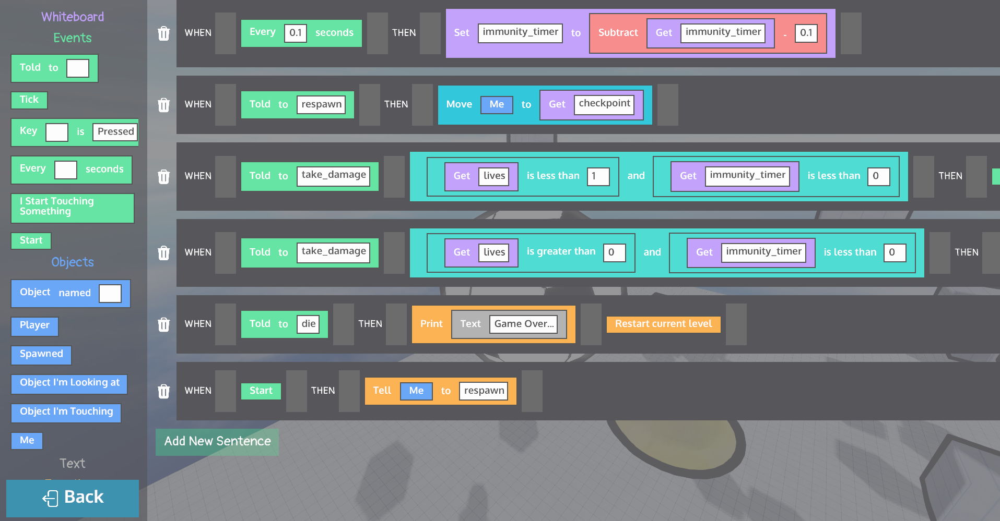
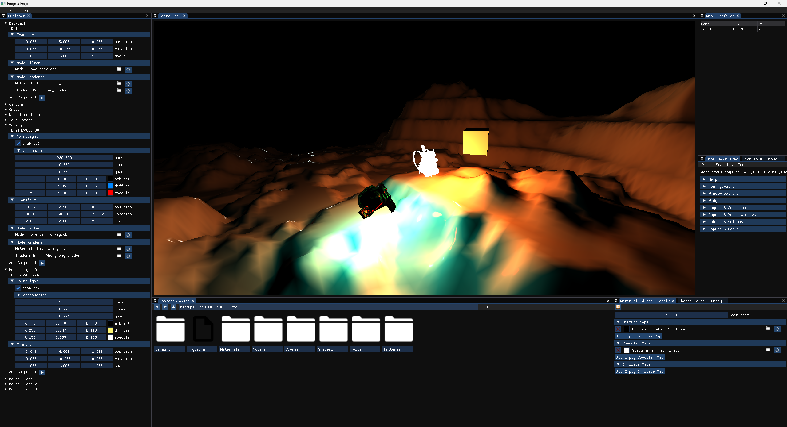
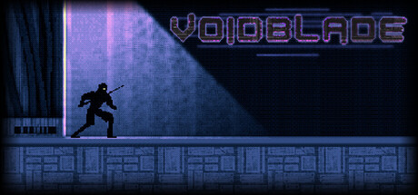

# Projects
## [Kreg's Toolbox](https://youtu.be/5XQm3lwc3t8?si=-XxvSa6-BaWbq6n0)
[Kreg's Toolbox](https://youtu.be/5XQm3lwc3t8?si=-XxvSa6-BaWbq6n0) was my Junior project at the DigiPen Institute of Technology. The game was designed to be a sandbox inspired by games like Dreams and Garry's Mod.

My primary contributions to this project were a custom scripting language - Prose (which gets it's own section), a custom Entity Component System, our Level System, and our Serialization Systems.
### Prose
Prose is the scripting language I created for Kreg's Toolbox, and outside of my work at Insomniac Games it is my favorite thing I have ever made. I was responsible for the back end, and [Gabe Krahulik](https://gabekrahulik.dev/) was responsible for the Drag'n'Drop front end. 

We had a vision of making an "English-like" scripting language that could be easily interpreted in a drag'n'drop blocks format (inspired by Scratch). In the end, I think we accomplished that goal.

Prose is composed of 3 main parts:
1. The Block-Based Front End ([See Gabe's write-up on the UI design of Prose](https://gabekrahulik.dev/writing/prose-scripting))
2. The Interpreter
3. The Virtual Machine
#### The Interpreter
The interpreter is a two-stage [Pratt Parser](https://en.wikipedia.org/wiki/Operator-precedence_parser#:~:text=1%20is%20returned.-,Pratt%20parsing,-edit). The first stage scans the source code and splits out each "Phrase" of each "Sentence" into it's own interpretation unit. Then, when an entity is "Told" to run a Sentence, the interpreter can spit out the instructions for each *phrase* of the *sentence* for the Virtual Machine to run.
#### The Virtual Machine
The virtual machine executes the byte code instructions from the Interpreter stage. A large part of making the language usable though was creating an API that let us bind c++ functions to be called by the Virtual Machine.

## [Enigma Engine](https://github.com/brubadue/Enigma_Engine)
[Enigma Engine](https://github.com/brubadue/Enigma_Engine) was a hobby 3D game engine of mine over the Summer of 2025, featuring a Custom Editor, OpenGL Renderer, and Entity Component System.
#### Outcomes:  
- I built a custom 3D renderer using OpenGL, supporting Shaders and Materials. 
- I created a custom editor using Dear ImGui, featuring an Asset Browser, live component editing, runtime inspection, and support for custom editors for each component. 
- I designed and implemented a custom Entity Component System architecture capable of supporting 30,000 entities. 
- I created and designed a custom Resource Manager with support for JSON metadata, hot reloading, and ref-counted lifetime management.  
- I implemented serialization using JSON for Modern C++
## [VOIDBLADE](https://store.steampowered.com/app/4371580/VOIDBLADE/)

\
[See it on Steam!](https://store.steampowered.com/app/4371580/VOIDBLADE/)

*VOIDBLADE is a 2D stealth platformer centered around dynamic lighting, in which the player must avoid, deceive, and destroy deadly robots in the shadows of an interstellar freighter. You play as a shadow ninja who has infiltrated a dilapidated, droid-operated freighter that is transporting a powerful Void Core; A power source that you desperately need. You must use the arcane powers of the shadows to navigate this deadly spacecraft and escape with the Void Core alive.*

I was both the Producer of this 7-person team and a Core Engine/Tools Programmer. 
- As a Producer, I handled the organization of the team – Documents, meeting times, scheduling, and morale.
- As an Engine Programmer, I created my first (but certainly not last) custom entity component system, a subscriber based messaging system, and a highly flexible particle system.
- As a Tools Programmer, I was the primary architect of our Lua scripting system, where I wrote all of the bindings, documentation, and a pre-processor for tagging variables in-code to expose them to the editor when saved. I also created several tools with Dear-ImGui, like a runtime scene-switching menu, entity outlining tool, etc..

I also made the music and sound effects for the game :)
